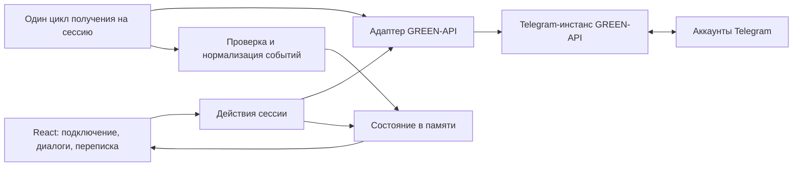

# Инструкция агенту-кодеру: Telegram-чат на React и GREEN-API

Дата проверки документации: **12 октября 2026 года**.

> Обновление: пользователь поручил реализацию и публикацию на GitHub Pages.
> Исходный документ ниже сохранён как проектный план. Его прежний запрет
> реализации/публикации отменён новым запросом. Актуальные запуск, проверки,
> ограничения и выпуск через `npm version` описаны в [README](README.md).

Этот документ — план последующей реализации. По текущему запросу пользователя выполнены исследование API и консультация отдельного агента по архитектуре чатов. Код приложения не создавался и не изменялся. На момент исследования в проекте была только папка `.git`, без исходников и коммитов; локальных `AGENTS.md` не обнаружено.

## 1. Решение и границы задания

Реализовать минимальный веб-чат на **React + TypeScript + Vite**, работающий с **Telegram через GREEN-API**. Пользователь вводит параметры своего инстанса, создаёт личный чат по телефону, отправляет текст и видит ответ собеседника из Telegram.

GREEN-API действительно предоставляет [API для Telegram](https://green-api.com/telegram/docs/). Использовать его напрямую, сохраняя обязательный сервис из задания. Telegram Bot API, собственная MTProto-интеграция и Telegram Mini App для этого сценария не нужны.

Требования на приложенном изображении — исходное ТЗ, адаптируемое к выбранному пользователем Telegram. Они не означают поручение сейчас реализовать или опубликовать приложение. Исходное ТЗ прямо допускает Telegram вместо MAX.

| Исходное требование | Решение для реализации |
| --- | --- |
| React, срок пять дней | Небольшая SPA, без SSR и собственной базы данных |
| Использовать GREEN-API | Telegram-инстанс GREEN-API |
| Отправлять и получать только текст | Личные диалоги; обычный текст и текст со ссылкой |
| Вход через `idInstance`, `apiTokenInstance` | Форма подключения; дополнительно `apiUrl` из кабинета |
| Создать чат по телефону | Проверить номер через `checkAccount`, сохранить полученный `chatId` |
| Отправка через `sendMessage` | Одноимённый метод Telegram-раздела документации |
| Получение через HTTP API | Последовательные `receiveNotification` и `deleteNotification` |
| Прототип внешнего вида — MAX Web | Сохранить привычную компоновку: список диалогов, переписка, поле ввода |
| Минимальный набор функций | Без групп, файлов, звонков, поиска истории, реакций и редактирования |

Ссылки `/v3/docs/...` на изображении относятся к MAX. Для реализации брать методы из `/telegram/docs/...`; механически переносить контракты MAX/WhatsApp нельзя. Внешний ориентир остаётся [MAX Web](https://web.max.ru/), хотя транспорт выбран Telegram. Авторизованный интерфейс MAX в рамках исследования не просматривался: точное визуальное совпадение не подтверждено. Не выдавать проектируемый макет за проверенную копию.

## 2. Что подтверждено и что ещё проверить

**По документации подтверждены:** Telegram-инстансы, работа от существующего аккаунта, разрешение телефона в `chatId`, отправка текста, HTTP-очередь уведомлений, форматы событий и настройки. [Начало работы](https://green-api.com/telegram/docs/before-start/).

**На живом инстансе не проверены:** CORS, доступность конкретного API-хоста, фактическая доставка, порядок событий и особенности аккаунта. Учётных данных не было; реальные сообщения, изменения настроек и публикация не выполнялись.

До основной вёрстки выполнить короткую интеграционную проверку с выделенным тестовым аккаунтом и вторым Telegram-аккаунтом получателя:

1. Создать Telegram-инстанс в кабинете GREEN-API, авторизовать существующий аккаунт, скопировать `apiUrl`, `idInstance`, `apiTokenInstance`. QR/код/2FA выполнять в кабинете; собственный экран Telegram-авторизации в MVP не строить.
2. Проверить состояние и настройки инстанса. Убедиться, что эту очередь не читает другая интеграция, вкладка кабинета с чатами или отдельный скрипт.
3. Из браузера проверить весь цикл `checkAccount → sendMessage → receiveNotification → deleteNotification`, включая CORS preflight для POST/DELETE. Проверить localhost и будущий адрес публикации. Успешный запрос из терминала не подтверждает CORS.
4. Сопоставить `chatId` из проверки телефона с `senderData.chatId` входящего ответа. Сохранить обезличенные образцы обычного текста, текста со ссылкой, API-эхо и статуса как тестовые fixtures.
5. Зафиксировать результат в README. Если credentials пока отсутствуют, делать интерфейс и тесты с подменённым API, явно отметить незавершённую живую проверку. Не объявлять mocked-проверку подтверждением доставки.

Базовый вариант — запросы из браузера. Если CORS не проходит, использовать резерв из раздела 11. Не тратить остаток срока на попытки исправить чужой CORS через `mode: "no-cors"` или только Vite dev proxy.

## 3. Подготовка инстанса и ограничения тарифа

Для демонстрации подходит тариф **Telegram Developer**: на дату проверки он бесплатный, поддерживает три чата и 100 вызовов CheckAccount в месяц. Смешивание телефона `phone@c.us` и числового `chatId` одного получателя может занять два места в квоте. Поэтому всегда отправлять по полученному `chatId`, а результаты проверки телефона кешировать в текущей сессии. Перед демонстрацией перепроверить условия тарифа. [Тарифы и квоты](https://green-api.com/en/telegram/docs/about-tariffs/).

Вручную подготовить следующие настройки выделенного инстанса:

```json
{
  "webhookUrl": "",
  "incomingWebhook": "yes",
  "outgoingAPIMessageWebhook": "yes",
  "outgoingMessageWebhook": "yes",
  "outgoingWebhook": "yes",
  "stateWebhook": "yes"
}
```

`incomingWebhook` включает входящие сообщения; `outgoingAPIMessageWebhook` — эхо API-отправок; `outgoingMessageWebhook` — сообщения из мобильного/настольного Telegram; `outgoingWebhook` — статусы; `stateWebhook` — состояние инстанса. Это строковые значения `yes`/`no`. Не вызывать `setSettings` при каждом подключении: он перезапускает инстанс, применение может занять до пяти минут. MVP только проверяет настройки и объясняет необходимые изменения. [SetSettings](https://green-api.com/telegram/docs/api/account/SetSettings/).

При непустом `webhookUrl` HTTP-получение работать не будет. Не очищать существующий webhook автоматически. HTTP-очередь хранит уведомления до 24 часов и требует подтверждения обработки каждого элемента. Это очередь событий, а не архив переписки. [Технология HTTP API](https://green-api.com/telegram/docs/api/receiving/technology-http-api/).

## 4. Контракты API

Базовый путь: **`{apiUrl}/waInstance{idInstance}`**. Префикс `waInstance` сохраняется и для Telegram. `apiUrl` брать из кабинета, не выводить из номера инстанса и не подставлять универсальный хост из примера SDK. [Формат запросов](https://green-api.com/en/telegram/docs/request-format/).

| HTTP | Путь после базового | Тело / результат |
| --- | --- | --- |
| GET | `/getStateInstance/{token}` | Ответ с `stateInstance` |
| GET | `/getSettings/{token}` | Настройки получения уведомлений |
| POST | `/checkAccount/{token}` | `{ "phoneNumber": <integer> }` → `exist`, `chatId` |
| POST | `/sendMessage/{token}` | `{ "chatId": "<id>", "message": "<text>" }` → `idMessage` |
| GET | `/receiveNotification/{token}?receiveTimeout=30` | `{ receiptId, body }` либо отсутствие события |
| DELETE | `/deleteNotification/{token}/{receiptId}` | `{ result, reason }` |

Здесь `token` — введённый пользователем `apiTokenInstance`, а не токен бота. URL с токеном формирует только API-адаптер; его нельзя выводить в логи или текст ошибки.

### Телефон и создание чата

Использовать **`checkAccount`**, не `checkTelegram`. Номер хранить строкой, принимать международный формат с кодом страны. Разрешить один ведущий `+`, пробелы, скобки и дефисы; удалить их при нормализации, остальные посторонние символы отклонить. После нормализации требовать непустую строку цифр с первой цифрой 1–9. Не заменять автоматически начальную `8` на `7`. Ограничить ввод максимумом 15 цифр, на границе API проверить `Number.isSafeInteger` и передать целое число.

Вызывать проверку по кнопке «Создать чат», не при каждом вводе символа; `force` оставить по умолчанию. При `exist: true` и непустом `chatId` открыть или создать локальный диалог. При `exist: false` показать: «Аккаунт не найден по номеру или номер скрыт настройками приватности». Проверять бизнес-ошибки в теле даже при HTTP 200. [CheckAccount](https://green-api.com/telegram/docs/api/service/CheckAccount/).

Ключ чата — числовая **строка `chatId`**, телефон — отдельный атрибут. Не вычислять ID из телефона и не переводить ID сообщений в JS Number. `phone@c.us` поддерживается для совместимости отправки, но в выбранном сценарии не используется. [Идентификатор чата](https://green-api.com/telegram/docs/api/chat-id/).

### Подключение и отправка

Отправку разрешать при `stateInstance === "authorized"`. Для `starting`, `notAuthorized`, `pendingPassword`, `blocked`, `suspended` выводить понятное состояние; не считать любой HTTP 200 успешной авторизацией. При `starting` разрешить повторную проверку с задержкой. Кнопка «Отключиться» завершает только локальную сессию и не вызывает API `logout`. [GetStateInstance](https://green-api.com/telegram/docs/api/account/GetStateInstance/).

Пустой или состоящий из пробелов текст отклонять. Сохранять содержательные переносы и пробелы пользователя; не обрезать текст молча. Лимит GREEN-API Telegram — 4096 символов; проверить границу с emoji на живом API и закрепить поведение тестом. Ответ `idMessage` означает принятие в очередь, а не доставку получателю. [SendMessage](https://green-api.com/telegram/docs/api/sending/SendMessage/).

## 5. Архитектура приложения

Выбрать React, TypeScript strict, Vite, обычный `fetch`, CSS Modules. Для небольшого синхронного хранилища с выборочными подписками использовать Zustand без middleware сохранения; чистые функции нормализации и обновления сущностей держать отдельно. Не добавлять роутер, UI-kit, React Query и серверную БД без возникшей необходимости. Зафиксировать совместимые стабильные версии и lockfile при реализации; Node выбрать поддерживаемый используемой версией Vite и закрепить одинаково локально/в CI/на хостинге.



Предлагаемая структура, которую создаст будущий кодер:

```text
src/
  app/                   # композиция экранов, общие стили
  api/                   # клиент GREEN-API, DTO, проверки ответов, ошибки
  session/               # подключение, остановка, владение очередью
  chat/                  # store, модели, нормализаторы, send/polling services
  components/            # ConnectionForm, ChatList, NewChatForm,
                         # ChatHeader, MessageList, MessageBubble, Composer
  test/                  # обезличенные fixtures и общая настройка тестов
README.md
IMPLEMENTATION_PLAN.md
```

Внутренние сущности:

| Сущность | Минимальное содержимое |
| --- | --- |
| Session | `sessionGeneration`, credentials отдельно от UI-состояния, состояние подключения |
| Chat | `chatId`, необязательные телефон/имя, черновик, unread count |
| Message | стабильный `localId`, необязательный `idMessage`, `chatId`, направление, текст, время, состояние отправки |
| Pending status | серверный ключ сообщения, статус, время события |
| Polling state | active/stopped/reconnecting/error, последняя безопасная ошибка |

Все запросы используют снимок сессии. Результат старой сессии не имеет права менять новую. Для UI достаточно списка созданных пользователем диалогов и личных диалогов, появившихся из входящего текста. Не загружать все контакты и историю аккаунта ради пустого экрана.

## 6. Получение событий: обязательная логика

### Один последовательный цикл

`receiveNotification` возвращает один элемент. `receiveTimeout` допускает 5–60 секунд; в SPA выбрать 30 секунд и клиентский timeout, например, 40 секунд. Пустое тело и JSON `null` трактовать как отсутствие события, не как ошибку парсинга. Без ACK повторяется прежний элемент. [ReceiveNotification](https://green-api.com/telegram/docs/api/receiving/technology-http-api/ReceiveNotification/).

Алгоритм проектируемого poller:

1. Получить исключительное владение очередью текущей сессии.
2. Выполнить один receive и проверить, что сессия ещё актуальна.
3. При пустом результате продолжить long polling; не запускать параллельный запрос.
4. Проверить envelope, инстанс и тип события; нормализовать событие.
5. Синхронно применить его к store либо сознательно классифицировать как неподдерживаемое.
6. Подтвердить именно полученный `receiptId` через DELETE.
7. Начать следующий receive после завершения обработки ACK.

Не использовать `setInterval`. Poller принадлежит сессии, а не активному чату. Переключение диалога не отменяет получение сообщений для остальных диалогов.

При сетевом сбое ACK повторить удаление с задержкой; повторная доставка должна быть безопасной. `result: false` не равен успешному удалению: разобрать `reason`, перечитать очередь; уже удалённый receipt не должен зациклить приложение. Если тот же receipt остаётся после ограниченного числа попыток, остановиться с понятной ошибкой. [DeleteNotification](https://green-api.com/telegram/docs/api/receiving/technology-http-api/DeleteNotification/).

Известные медиа, групповые сообщения и неподдерживаемые сервисные события подтверждать после классификации, не загружая файлы. В личном чате допустима нейтральная строка «Этот тип сообщения не поддерживается». Повреждённый envelope, несовпадающий инстанс или неожиданная схема поддерживаемого текста — диагностическая ошибка: остановить цикл, не удалять необработанное событие молча. Не вызывать очистку всей очереди для устранения ошибок.

### Нормализация уведомлений

| `body.typeWebhook` | Источник `chatId` | Действие |
| --- | --- | --- |
| `incomingMessageReceived` | `senderData.chatId` | Добавить/обновить входящее сообщение |
| `outgoingAPIMessageReceived` | `senderData.chatId` | Объединить эхо API с исходящим сообщением |
| `outgoingMessageReceived` | `senderData.chatId` | Добавить исходящий текст из Telegram владельца |
| `outgoingMessageStatus` | `body.chatId` | Обновить статус, не создавать текстовую реплику |
| `stateInstanceChanged` | Событие сессии | Обновить состояние подключения; остановить отправку при потере авторизации |

Для `typeMessage: "textMessage"` читать `messageData.textMessageData.textMessage`; для `"extendedTextMessage"` — `messageData.extendedTextMessageData.text`. Второй формат нужен и для текста со ссылкой. Направление определять по типу события, диалог — по ID из события, а не по открытому экрану. Время UNIX в секундах переводить в миллисекунды один раз. [Входящий текст](https://green-api.com/telegram/docs/api/receiving/notifications-format/incoming-message/TextMessage/), [текст с URL](https://green-api.com/telegram/docs/api/receiving/notifications-format/incoming-message/ExtendedTextMessage/), [исходящее API-сообщение](https://green-api.com/telegram/docs/api/receiving/notifications-format/outgoing-message/OutgoingApiMessage/).

### Дедупликация и порядок

Ключ серверного сообщения: **`sessionGeneration + idInstance + canonicalChatId + idMessage`**. `idMessage` уникален только внутри чата и текущей авторизации инстанса. После переподключения локальную сессию начинать заново; после обнаруженной переавторизации сбрасывать старые соответствия. `receiptId` — идентификатор уведомления, он не заменяет ключ сообщения. [Идентификатор сообщения](https://green-api.com/telegram/docs/api/message-id/).

Upsert сообщения и применение статуса — разные операции. Нельзя игнорировать статус лишь потому, что такой `idMessage` уже есть. Статус, пришедший до текста/ответа send, временно хранить по серверному ключу. Сортировать по времени с устойчивым локальным порядком при совпадении времени; не сортировать непрозрачные ID как номера.

### Lifecycle и сеть

- При отключении/смене credentials отменять fetch и ожидания через AbortController, останавливать цикл, очищать токен и данные. Generation guard обязателен также для send/checkAccount.
- React StrictMode не должен оставлять второй работающий poller. Cleanup должен симметрично отменять запуск. [React useEffect](https://react.dev/reference/react/useEffect).
- В рамках одного origin использовать Web Locks с ключом по `apiUrl + idInstance`, без токена. Второй вкладке показывать, что этот инстанс уже открыт. Не поддерживающий Web Locks браузер не должен незаметно запускать второго потребителя; показать ограничение поддерживаемого браузера. [Web Locks](https://developer.mozilla.org/en-US/docs/Web/API/Web_Locks_API).
- Блокировка вкладок не распространяется на другой браузер, устройство или preview-домен. Для демо использовать один потребитель очереди во всех средах.
- На временных ошибках receive/ACK применять backoff, например 1, 2, 4, 8, 16, 30 секунд с jitter; ожидание отменяемое. На HTTP 429 учитывать корректный `Retry-After`, если он доступен.
- Ошибки credentials, конфигурации и квот не повторять бесконечно. `checkAccount` с ограничением Telegram тоже не опрашивать коротким циклом. Отдельно обрабатывать сетевую недоступность и ошибки тела при HTTP 200.
- Не обещать непрерывную работу закрытой или выгруженной браузером вкладки. После возобновления продолжать единственный цикл, без параллельного «догоняющего» запроса.

Учитывать лимиты методов: частые повторы кнопки проверки состояния/настроек блокировать, их текущий предел — один запрос в секунду на метод/инстанс. [Ограничения частоты](https://green-api.com/telegram/docs/api/ratelimiter/).

## 7. Отправка, статусы и неоднозначный результат

Перед запросом создать локальную попытку с `localId` и состоянием «Отправляется». Захватить `chatId` и текст в момент нажатия; последующее переключение чата не меняет адресата. Защитить отправку от двойного клика/повторного Enter. Во время запроса пользователь может писать следующий черновик: поздний ответ не должен его стереть.

После успешного ответа привязать `idMessage`, объединить эхо и отложенные статусы. «Принято сервисом» устанавливать только при отсутствии уже полученного серверного статуса: поздний HTTP-ответ не перезаписывает `delivered`, `read`, `failed` или `noAccount`. Если эхо уже пришло раньше, объединить сущности по серверному ключу и убрать временный дубль. Совпадение текста и времени не является идентификатором: два одинаковых сообщения могут быть отправлены намеренно.

Статусы Telegram API: `delivered`, `read`, `failed`, `noAccount`. Показывать доставку/прочтение только по событиям; `read` не понижать поздним `delivered`. `failed`/`noAccount` обрабатывать даже при выключенных обычных статусах. Если в ошибке нет `idMessage`, показать ошибку чата, не назначать её произвольной реплике. Для `chatId unresolvable on this session` предложить повторную проверку контакта. [Статусы сообщений](https://green-api.com/telegram/docs/api/receiving/notifications-format/statuses/OutgoingMessageStatus/).

**Не выполнять автоматический повтор `sendMessage`.** При timeout, потере соединения или неоднозначном 5xx запрос мог быть принят. Отметить попытку как «Результат неизвестен», предложить проверить переписку и повторить вручную с пояснением возможности дубля. Документированный клиентский ключ идемпотентности у sendMessage не указан. Без полученного `idMessage` нельзя надёжно сопоставить такую попытку с эхо; не угадывать по тексту. Неизвестную попытку можно показывать отдельным уведомлением рядом с перепиской.

При явном отклонении запроса сохранить текст для редактирования/повтора. Сообщение о квоте 466 или ограничении 469 должно объяснять проблему, а не выглядеть как вечный спиннер. Все сервисные описания выводить как обычный текст.

## 8. Интерфейс и пользовательские состояния

Русскоязычный интерфейс, нейтральное название «Telegram-чат · GREEN-API». Светлый фон, спокойный акцент, читаемые сообщения. Не добавлять декоративные элементы, которые отвлекают от тестового сценария.

**Экран подключения:** `idInstance`, скрытый `apiTokenInstance` с переключателем видимости, `apiUrl` с подсказкой «из кабинета GREEN-API», кнопка «Подключиться», локальные ошибки полей и индикатор проверки. Три поля оправданы реальным контрактом подключения; не угадывать хост ради буквального сохранения двух полей из ТЗ.

**Экран чата:** слева список диалогов и «Новый чат», справа заголовок, лента и textarea с кнопкой отправки. В строке диалога — имя или телефон/ID, последний текст, непрочитанные. Не выдумывать имя, если оно неизвестно. При входящем личном тексте из неизвестного чата создать строку диалога по ID, не переключая пользователя насильно.

**Пустые и ошибочные состояния:** ещё нет чатов, чат без сообщений, проверка номера, аккаунт не найден/скрыт, API недоступен, инстанс не авторизован, приём восстанавливается, лимит тарифа, неопределённый результат отправки. Не полагаться исключительно на кратковременный toast.

На узком экране показывать список или выбранный чат с кнопкой «Назад». Поле ввода остаётся доступным при открытии экранной клавиатуры. Обеспечить label для полей, видимый focus, клавиатурную навигацию, текстовые статусы, корректный контраст.

Enter отправляет, Shift+Enter вставляет перенос; во время IME composition Enter не отправляет. Длинные слова и URL переносятся, переносы строк сохраняются. Автопрокрутка — если пользователь был у нижнего края или отправил сообщение; при чтении старых сообщений показать «Новые сообщения».

## 9. Данные и безопасность демо

Проектное решение MVP: credentials, переписка, черновики и соответствия телефонов хранятся **только в памяти вкладки**. После refresh/отключения они теряются. Обработанные и удалённые уведомления не возвращаются как история. Это ограничение явно указать в форме/README. Восстановление истории через отдельный API, IndexedDB или БД не входит в исходное ТЗ.

В прямой SPA пользователь вводит свой токен; он доступен этому браузеру и виден в его Network. Не заявлять, что frontend способен скрыть секрет от владельца браузера. Общий токен автора в публичную сборку не включать.

- Не сохранять token в localStorage/sessionStorage, URL страницы, Git, fixtures, скриншотах, отчётах или аналитике. Не подключать запись пользовательских сессий.
- Не передавать секреты через `VITE_*`: эти переменные встраиваются в клиентскую сборку. [Переменные окружения Vite](https://vite.dev/guide/env-and-mode).
- Проверять `apiUrl` через URL parser: только HTTPS, разрешённые хосты GREEN-API из проверенного списка, без userinfo/query/hash/нестандартного порта и произвольного пути. Для исследованного хоста `*.api.green-api.com` проверять границу домена; новые официальные домены добавлять после проверки, не разрешать произвольный URL.
- Изолировать данные по сессии. В ошибках показывать метод и безопасное описание, не сырой fetch URL/stack или ответ с секретами.
- Текст сообщений выводить средствами React, без `dangerouslySetInnerHTML`. Для MVP URL могут оставаться текстом; генерация HTML и загрузка превью не нужны.

## 10. Публикация: рекомендуемый вариант

**Рекомендация для сдачи: Git-репозиторий + статический deploy на Netlify после подтверждения CORS.** Это соответствует выбранной SPA: хостинг отдаёт сборку, а HTTP-получение выполняется в браузере. Постоянный процесс Node на хостинге не требуется.

Порядок для будущей реализации:

1. Подготовить репозиторий, README, lockfile и команды `dev`, `build`, `preview`, `lint`, `typecheck`, `test`, `test:e2e`. Добавить игнорирование реальных `.env`, `node_modules`, `dist`, локальных отчётов с чувствительными данными.
2. Выполнить установку по lockfile, проверки и production build. В CI не использовать реальные токены: автоматические проверки работают на fixtures.
3. Импортировать репозиторий в Netlify. Build command: `npm run build`; publish directory: `dist`; Node — закреплённая версия проекта. Публиковать из выбранной рабочей ветки после проверок.
4. Оставить один URL `/` без клиентского роутера. Если позднее появятся маршруты, добавить SPA rewrite на `index.html` и проверить прямое открытие вложенного URL. [Vite на Netlify](https://docs.netlify.com/build/frameworks/framework-setup-guides/vite/).
5. Настроить заголовки: `Referrer-Policy: no-referrer`, `X-Content-Type-Options: nosniff`, CSP с ограниченным `connect-src` для разрешённых API-хостов, `object-src 'none'`, `base-uri 'self'`, `frame-ancestors 'none'`. Проверить CSP на итоговой сборке, не маскировать ею CORS-ошибки. [Заголовки Netlify](https://docs.netlify.com/manage/routing/headers/).
6. Проверить HTTPS-адрес с той сети, из которой будет смотреть проверяющий: загрузка приложения и API-хоста, GET/POST/DELETE, отправка и ответ, мобильная компоновка, refresh и отключение. Учесть, что ограничения доступности сети нельзя проверить только локальной сборкой.
7. Передать ссылку, исходники и короткую инструкцию: создать/авторизовать Telegram-инстанс, настроить уведомления, ввести свои параметры, указать номер тестового получателя. В README выделить выбранную замену MAX на Telegram и ограничение истории.

Vercel — допустимая альтернатива с Vite preset и каталогом `dist`; GitHub Pages — запасной вариант для чистой SPA с правильно выставленным `base` под путь репозитория. `vite preview` применять для локальной проверки сборки, не как production-сервер. [Публикация Vite](https://vite.dev/guide/static-deploy.html).

Не обещать неизменность бесплатных тарифов хостинга: условия проверить в момент публикации. По текущему запросу публикацию не выполнять. Сам факт наличия этого плана не разрешает будущему агенту покупать тариф или домен.

## 11. Резерв при невозможности прямых браузерных запросов

Если обязательная CORS-проверка не прошла, сохранить архитектуру чата и заменить транспорт на **небольшой same-origin BFF**. Это заранее предусмотренное решение, а не переход на другой мессенджер.

Минимальный вариант — stateless relay: браузер делает POST на свой `/api/green`, передавая в JSON credentials, разрешённую операцию и её аргументы. Relay формирует upstream GET/POST/DELETE только для шести методов из раздела 4. Poller остаётся в браузере; один запрос relay соответствует одному upstream-запросу. Credentials не передавать в URL своего сайта и не сохранять на сервере.

Сервер должен проверять точные upstream-хосты, разрешённые операции и DTO, запрещать redirects на сторонние адреса, ограничивать размер тела/частоту запросов, отключить кеширование (`Cache-Control: no-store`) и запись тел запросов/секретов в логи. Нельзя публиковать универсальный открытый proxy. Добавить ограничение origin и серверную защиту от злоупотребления; проверка Origin сама по себе не является аутентификацией.

Это обход CORS, а не обещание скрыть введённый пользователем токен от его браузера. Для настоящих серверных сессий с httpOnly-cookie, централизованной очередью и долговременной историей нужен отдельный объём работ.

Для relay выбрать Node web service с reverse proxy под тем же origin либо функцию с документированным лимитом выполнения больше upstream timeout. Перед выбором serverless проверить актуальные лимиты: при необходимости использовать `receiveTimeout=5` и достаточный запас до server/client timeout. Не запускать бесконечный цикл, cron или «фоновый poller» внутри функции. Альтернатива без этих ограничений — один обычный Node-процесс, раздающий `dist` и API на VPS; HTTPS, restart policy и секреты настраиваются отдельно.

Не использовать сторонние публичные CORS-прокси для токенов. Замена получения на provider webhook endpoint не нужна: исходное ТЗ требует HTTP API.

## 12. Проверки и критерии приёмки

Автотесты должны проверять поведение, а не копировать реализацию. Использовать Vitest для чистой логики, React Testing Library для форм и Playwright для нескольких сквозных сценариев с подменённой сетью. Любые credentials и номера в fixtures — вымышленные.

| Проверка | Ожидаемый результат |
| --- | --- |
| Подключение с корректными параметрами | Переход к чатам при авторизованном и настроенном инстансе |
| Неверный токен / `starting` / HTTP 200 с бизнес-ошибкой | Понятная ошибка или состояние ожидания, без ложного успеха |
| Форматированный международный телефон | Один `checkAccount` по кнопке, чат по canonical ID |
| Повторное создание того же контакта | Открывается существующий диалог |
| Скрытый/не найденный номер | Корректная неоднозначная формулировка, отправка не начинается |
| Обычный текст, ссылка, emoji и переносы | Содержимое сохраняется в обе стороны |
| Пустой текст / граница 4096 / превышение | Валидная отправка либо понятная ошибка без молчаливой обрезки |
| Двойной клик, IME, смена чата во время send | Одна попытка; правильный адресат; новый черновик не теряется |
| Эхо до/после ответа send | Одна подтверждённая реплика после объединения |
| Повтор receipt после ошибки DELETE | Нет дубля текста; ACK повторяется отдельно |
| Один `idMessage` в двух чатах | Две разные сущности, статусы не смешиваются |
| `read` до `delivered`, статус раньше эхо | Статус сохраняется и не понижается |
| Timeout send | «Результат неизвестен», автоматического повтора POST нет |
| Нетекстовое/неподдерживаемое событие | Очередь продвигается после классификации |
| Входящий текст в неактивный чат | Сообщение в нужном диалоге, unread, без смены открытого чата |
| StrictMode, две вкладки, disconnect во время receive | Один владелец; после отключения нет новых запросов/старых обновлений |
| Сетевой сбой, 429, 466, потеря авторизации | Задержка либо остановка по политике, без плотного цикла запросов |
| HTML-подобный текст | Показывается как текст, ничего не исполняется |
| Refresh | Новое подключение, ожидаемо пустая локальная история |

Финальная живая проверка: отправитель открывает опубликованный сайт → вводит свои данные → создаёт чат по телефону → отправляет текст → получатель отвечает из обычного Telegram → ответ появляется в том же чате. Это главный критерий, его нельзя заменить скриншотом или mock-тестом.

Перед сдачей должны проходить lint, typecheck, unit/component-тесты, выбранные e2e и build. Проверить production-сборку на настольном и узком экране. README содержит реальные команды запуска, подготовку инстанса, настройки, ссылку на demo, особенности CORS и ограничения MVP. Не включать токен автора в скриншоты или видео.

## 13. План на пять дней

| День | Результат |
| --- | --- |
| 1 | Живая проверка API/CORS, выбор транспорта, scaffold, типы/адаптер, форма подключения |
| 2 | Создание чата по телефону, store, список/лента/ввод, отправка и ошибки |
| 3 | Последовательное получение и ACK, нормализация, дедупликация, статусы, lifecycle |
| 4 | Проверки гонок и сбоев, мобильный интерфейс, доступность, preview deploy |
| 5 | Проверка с двумя Telegram-аккаунтами на опубликованном origin, исправления, README и сдача |

При нехватке времени сокращать косметику, аватары и дополнительные удобства. Не сокращать работающий ответ из Telegram, подтверждение очереди, защиту от дублей и честную обработку ошибок. Обнаруженный CORS-блокер решать в первый день, используя раздел 11.

## 14. Итог консультации специалиста по чатам

Отдельный агент изучил Telegram-документацию GREEN-API и рекомендовал SPA с состоянием в памяти и единственным владельцем очереди; BFF подключать при подтверждённой необходимости. Его замечания включены в этот план: `checkAccount` перед отправкой, канонический ID чата, составной ключ сообщений, обработка эхо/статусов вне зависимости от порядка, отмена старой сессии, ручной повтор неоднозначной отправки и явно обозначенное отсутствие долговременной истории.

При старте реализации агенту-кодеру сначала прочитать этот документ и актуальные инструкции репозитория, затем выполнять план. Не расширять MVP до полноценного Telegram-клиента и не подменять реальные проверки симуляцией. Если API изменился, перепроверить соответствующий первоисточник, обновить контракт и эту инструкцию перед продолжением.
